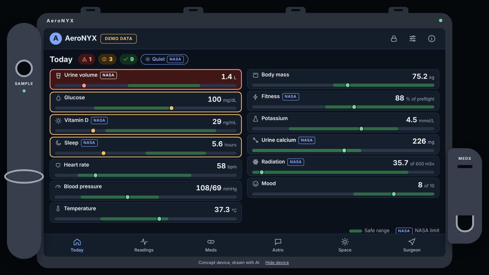
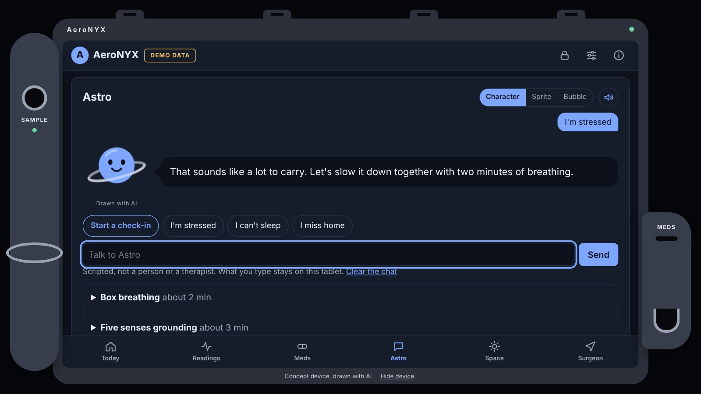
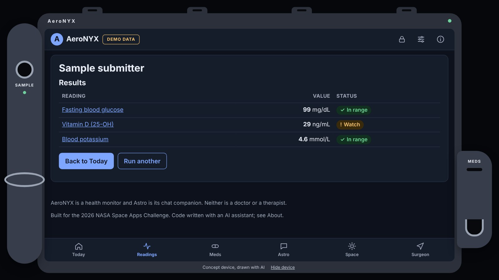
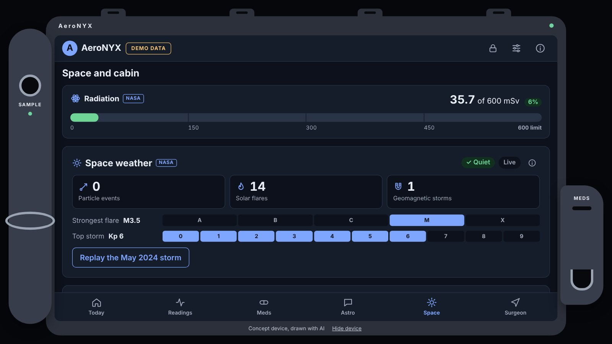

# AeroNYX: health monitoring for astronauts

AeroNYX helps an astronaut on a long mission keep track of their own health. It gathers readings, shows each one against the safe range and the crew member's own preflight baseline, tracks prescribed medication, and keeps the flight surgeon informed. **Astro** is its chat companion: a calm, scripted voice to talk to about stress, with a short mental health check-in.

The project was first called Astro. The repository and the web address keep that name.

Built for the 2026 NASA Space Apps Challenge: **Create Health Monitoring Software for Astronauts on Space Missions**.

**Live demo:** https://dhirajk8113.github.io/astro-health-companion/ (a first visit opens with the simulated demo data loaded)

**Demo video, 30 seconds:** https://dhirajk8113.github.io/astro-health-companion/media/aeronyx-demo.mp4



| Astro, the chat companion | A sample run | Real NASA data |
| --- | --- | --- |
|  |  |  |

These are screenshots of the running app. The device around the screen is a concept, drawn in code with an AI assistant from the team's sketch. No hardware exists. In the video the same device is drawn in more detail; it is still a drawing.

> AeroNYX is a health monitor and Astro is its chat companion. Neither is a doctor or a therapist, and neither diagnoses or treats. The demo readings are simulated, except the radiation dose.

## What it does

| Screen | What the crew member can do |
| --- | --- |
| Today | See every reading as a marker on a bar against its safe range, with the readings that need attention first and a NASA tag on the ones that use NASA's own limit. Tap one for what to do. |
| Sample submitter | Run a blood sample or a 24-hour urine collection. The analysis is simulated: it logs values close to the last readings and says so. |
| Readings | Log a reading, see it against the reference range and their own baseline, follow the trend on a chart, and read how to take the measurement and why it matters in space. |
| Medications | See what the flight surgeon prescribed from the onboard kit, record each dose (the dispenser is simulated), follow adherence, and see how the linked reading has moved since the medication started. |
| Astro | Talk to a companion that speaks: a character, a sprite or a speech bubble that writes out each reply and reads it aloud in the tablet's own voice. Talk about stress, sleep or missing home, do a three-question check-in by tapping numbers, get a calming activity, and be handed off to people when the ratings or the words call for it. |
| Space | See the mission radiation dose on a bar against NASA's 600 mSv career limit, with a warning when the limit is reached or a solar particle event is under way; NASA space weather as counts and scales; dose rates by mission; the station's live cabin readings as gauges; and today's signal delay to Mars. |
| Flight surgeon | Send a structured report to the ground and receive replies and prescriptions, with the signal delay for the chosen mission (ISS, Moon or Mars). |
| Setup | Enter preflight baselines, choose the mission, and load or clear the simulated demo data. |
| Lock | Scan a badge (simulated) and enter a four-digit PIN. The PIN is kept only as a salted hash, five wrong tries pause the keypad, and the tablet locks after five idle minutes. The lock closes the screens; it does not yet encrypt the stored record. |

AeroNYX follows 13 indicators: resting heart rate, blood pressure, body temperature, body mass (from the mass measurement device), aerobic capacity, fasting glucose, vitamin D, blood potassium, urine volume, urinary calcium, mission radiation dose, sleep and mood.

## One case, start to finish

The demo data carries one case through the whole loop. It is simulated, and it shows what the software is built to do.

1. A crew member's urinary calcium climbs over four weeks. AeroNYX shows the trend against the range and the crew member sends a report.
2. The report crosses the signal delay. The flight surgeon replies with a prescription from the onboard kit: potassium citrate, 20 mEq a day.
3. AeroNYX tracks each dose. About nine in ten are taken.
4. Urinary calcium averages 9 percent lower since the medication started. AeroNYX states this as a trend, not as proof of cause, and the flight surgeon sees the same numbers.
5. Today urine volume is 1.4 L, under the 1.5 L line where NASA says kidney stone risk increases. AeroNYX flags it, says to increase fluids and to tell the flight surgeon.

The five-step tour on the home screen walks through the same loop.

## Boundaries

- AeroNYX shows readings and tells the crew member when to involve a person. The flight surgeon makes the medical decisions.
- AeroNYX never chooses a medication or a dose.
- Everything AeroNYX shows, and every reply Astro gives, is fixed wording chosen by a rule in the code. There is no AI model inside the product, so it keeps working with no link to Earth.
- Astro is not a person or a therapist and says so. Words that signal a crisis always hand off to the crew medical officer and flag the flight surgeon.
- What a crew member types to Astro stays in the browser on the device. Only the three check-in ratings are reported to the flight surgeon.
- Everything is stored in the browser on the device. Nothing is uploaded.

## NASA data and resources used

AeroNYX is organised around NASA's Human Research Program framework, and its limits are NASA's wherever NASA publishes a number. Each indicator is tied to one of the five hazards of human spaceflight, each limit is labelled with its source on screen, and the About screen lists all 13.

| Limit | NASA number | NASA document |
| --- | --- | --- |
| Aerobic capacity | At or above 80 percent of the pre-mission value | NASA-STD-3001 Volume 1, Revision C, requirement V1 4003 |
| Mission radiation dose | Career effective dose below 600 mSv | NASA-STD-3001 Volume 1, Revision C, requirement V1 4030 |
| Vitamin D (25-OH) | Desired range 35 to 90 ng/mL; bands at 35 or higher, 20 to 34, under 20 | OCHMO-MTB-013 Bone Loss, Revision D |
| Urine volume | Normal 2 to 2.5 L a day; stone risk increases below 1.5 | HRP Evidence Report: Risk of Renal Stone Formation |
| Urinary calcium | Normal under 300 mg a day for men, under 250 for women | HRP Evidence Report: Risk of Renal Stone Formation |
| Sleep | Adults need 7 to 9 hours; crews average 6 to 6.5 in flight | OCHMO-TB-041 Sleep Accommodations, Revision B |

For the other seven indicators (resting heart rate, blood pressure, body temperature, body mass, fasting glucose, blood potassium and mood) NASA publishes no numeric in-flight limit, so AeroNYX shows the standard adult clinical range and the crew member's own baseline. The NASA numbers were checked against their source documents on 14 November 2026.

- [NASA Human Research Program: 5 Hazards of Human Spaceflight](https://www.nasa.gov/hrp/hazards/)
- [NASA Human Research Program: Human Health and Performance Risks](https://www.nasa.gov/hrp/risks/)
- [NASA Human Research Program: Ongoing Research](https://www.nasa.gov/hrp/ongoing-hrp-research/)
- [NASA-STD-3001 Volume 1, Revision C: Crew Health](https://standards.nasa.gov/sites/default/files/standards/NASA/C//nasa-std-3001-vol-1-rev-c-signature.pdf), for the aerobic capacity standard (V1 4003) and the career radiation limit (V1 4030)
- [OCHMO-MTB-013 Bone Loss, Revision D](https://www.nasa.gov/wp-content/uploads/2026/02/ochmo-mtb-013-bone-loss.pdf), for the vitamin D range
- [HRP Evidence Report: Risk of Renal Stone Formation](https://ntrs.nasa.gov/citations/20170004709), for the urine volume and urinary calcium reference values
- [OCHMO-TB-041 Sleep Accommodations, Revision B](https://www.nasa.gov/sites/default/files/atoms/files/sleep_accomodations_technical_brief_ochmo.pdf), for the sleep need and the in-flight average
- NASA Office of the Chief Health and Medical Officer technical briefs: [Exercise](https://www.nasa.gov/wp-content/uploads/2023/12/ochmo-tb-031-exercise-overview.pdf), [Orthostatic Intolerance](https://www.nasa.gov/wp-content/uploads/2023/12/ochmo-tb-019-orthostatic-intolerance.pdf), [Food and Nutrition](https://www.nasa.gov/wp-content/uploads/2023/12/ochmo-tb-013-food-and-nutrition.pdf), [Behavioral Health](https://www.nasa.gov/wp-content/uploads/2023/12/ochmo-tb-016-behavioral-health.pdf), [Radiation Protection](https://www.nasa.gov/wp-content/uploads/2023/03/radiation-protection-technical-brief-ochmo.pdf), [Urinary Health](https://www.nasa.gov/ochmo-mtb-003-urinary-health-2/)
- [NASA: Risk of Renal Stone Formation](https://www.nasa.gov/directorates/esdmd/hhp/risk-of-renal-stone-formation/) and [Risk of Spaceflight-Induced Bone Changes](https://www.nasa.gov/reference/risk-of-spaceflight-induced-bone-changes/)
- [NASA Space Radiation Analysis Group](https://srag.jsc.nasa.gov/SpaceRadiation/How/How.cfm), for how dose is monitored and the 600 mSv career limit
- [NASA evidence report on sleep loss](https://ntrs.nasa.gov/api/citations/20160003864/downloads/20160003864.pdf)

## Real NASA data in the app

AeroNYX reads or carries seven pieces of real data. None of it is simulated.

| Data | Source | How AeroNYX uses it | Live or saved |
| --- | --- | --- | --- |
| Space weather events | [NASA DONKI](https://ccmc.gsfc.nasa.gov/tools/DONKI/) | Environment screen: solar particle events, flares and storms from the last 30 days, with an alert on Today when instruments detect a particle event within 72 hours | Live, read by the browser |
| The May 2024 solar storm | NASA DONKI | A replay that shows the alert working on a real storm | Saved in `js/data/nasa-snapshots.js` |
| ISS radiation dose | [NASA OSDR RadLab](https://visualization.osdr.nasa.gov/radlab/gui/data-api/), DOSTEL-2 detector (DLR, ESA DOSIS 3D) | 61 days of measured daily dose. The demo's mission radiation dose replays them, so that one reading is real | Saved (RadLab cannot be read from another website) |
| Dose rate by mission | RadLab for the ISS, the [Artemis I measurements](https://www.ncbi.nlm.nih.gov/pmc/articles/PMC11446838/) for the Moon, [Curiosity's cruise to Mars](https://www.swri.org/newsroom/press-releases/swri-led-team-calculates-the-radiation-exposure-associated-trip-mars) | Days to NASA's 600 mSv career limit at each mission's measured rate | Saved |
| ISS cabin readings | NASA's public ISS telemetry feed | Environment screen: cabin temperature, pressure, carbon dioxide and tank levels against NASA-STD-3001 limits, each with the time the station sent it | Live, read by the browser with no library |
| Signal delay to Mars | [NASA JPL approximate planetary positions](https://ssd.jpl.nasa.gov/planets/approx_pos.html) | The one-way delay on the Flight surgeon and Environment screens is computed for today's date | Computed in the app |
| Inspiration4 blood chemistry | [NASA OSDR study OSD-575](https://osdr.nasa.gov/bio/repo/data/studies/OSD-575) | Glucose and potassium screens show the lowest and highest value among the four crew at each blood draw | Saved, group range only |

Most items in the medication kit are taken, with their strengths, from [NASA's ISS Medical Kit: Contents and Reference](https://www.nasa.gov/wp-content/uploads/2015/03/medical_kit_checklist_-_full_release.pdf) of 9 April 2015.

Limits of this data: DONKI reports events and carries no dose, so AeroNYX never turns an event into a dose figure. The ISS detector dose is converted to dose equivalent with the quality factor published by the DOSIS 3D team and is a detector reading, not a personal dose. The Inspiration4 samples were taken before and after a three-day flight, never in flight. The 2015 kit list is historical.

## Space agency partner and other resources

- German Aerospace Center (DLR) and ESA: the DOSTEL-2 detector of the DOSIS 3D experiment in ESA's Columbus module supplies the ISS dose measurements, and [Berger et al. 2017](https://www.swsc-journal.org/articles/swsc/abs/2017/01/swsc160046/swsc160046.html) supplies the quality factor used to convert them
- Canadian Space Agency: [Bio-Analyzer](https://asc-csa.gc.ca/eng/iss/bio-analyzer.asp), [Vascular studies](https://www.asc-csa.gc.ca/eng/sciences/vascular.asp), [Monitoring radiation for astronaut health](https://www.asc-csa.gc.ca/eng/news/articles/2026/2026-02-26-monitoring-radiation-astronaut-health.asp)
- German Aerospace Center (DLR): [core body temperature in astronauts](https://elib.dlr.de/116228)
- [Zwart et al. 2014, body mass changes during long-duration spaceflight](https://www.ncbi.nlm.nih.gov/pubmed/25197887)
- [Jones et al. 2022, sleep, stress and performance on the ISS](https://pmc.ncbi.nlm.nih.gov/articles/PMC8919197)

The three background research reports in `docs/research/` list every source consulted.

## What is real and what is simulated

- **Simulated:** the readings, prescriptions and check-ins in the demo data, except the mission radiation dose; the medication dispenser and its unit counts; the flight surgeon console. The Mars delay is real but compressed to 20 seconds in the demo.
- **Real:** everything in the table under "Real NASA data in the app".
- **From published sources:** why each indicator matters in space, the NASA limits quoted, and how each measurement is taken.
- **NASA limits:** six of the 13 indicators use a number NASA publishes (table above).
- **Standard clinical values:** the other seven. NASA publishes no numeric in-flight limit for them, so the ranges are standard adult values used on Earth, labelled as such on screen. A flight surgeon would set the real limits for each crew member.
- **Not included:** stool analysis, which has no in-flight analyzer today.

## Could this work?

- **The readings exist.** Every indicator is something crews already measure or that has flown. The sample submitter assumes an onboard analyser of the kind the Canadian Space Agency's Bio-Analyzer provides on the ISS, which works from a small sample.
- **The medications exist.** Eight of the kit items use the names and strengths in NASA's 2015 ISS medical kit list.
- **The limits are NASA's where NASA has one.** Six of the 13 safe ranges come from NASA-STD-3001 or a NASA brief, each linked to its document. The other seven are standard clinical ranges and say so.
- **The logic is checked.** 65 automated tests cover the status rules, the gauges, the medication comparison and Astro. They include a test that the green band on every gauge is the range the rules call in range, and tests that crisis wording always hands off to people.
- **It runs with no link to Earth.** There is no server and no AI model inside the product. Only the two live NASA panels need a connection, and they say so when there is none.

What is not done: no hardware, no connection to a real analyser or dispenser, and no clinical validation. Astro picks its replies by keywords, so it can misread a sentence.

## The concept device

On a wide window the app is drawn inside a device: a screen with a sample submitter on the left, a medication dispenser on the right and attachment clips on top. The shape is the team's own sketch; the drawing was made in code with an AI assistant and says so on the device. No hardware exists. Pressing the sample submitter starts a simulated sample run, and the dispenser drops a dose when one is dispensed. Neither is connected to anything. "Hide device" turns the drawing off. The demo video uses a more detailed drawing of the same device (`tools/film-device.js`), in which a specimen tube goes into the sample port and a capsule drops into the cup. That is animation, not hardware.

## Run it

AeroNYX is a static site with no build step and no dependencies.

```
python3 -m http.server 8000
```

Then open `http://localhost:8000`. A first visit loads the simulated demo data; Setup can clear it or load it again.

Run the tests with Node 20 or later:

```
npm test
```

## Layout

```
index.html            page shell
css/styles.css        styles, light and dark
js/app.js             events and storage wiring
js/views.js           screens
js/lib/assess.js      status rules, trends, adherence, report
js/lib/checkin.js     check-in rules and handoff
js/lib/chat.js        Astro's scripted replies
js/lib/sample.js      the simulated sample run
js/lib/icons.js       line icons, drawn in code
js/lib/persona.js     Astro's three looks and its on-device voice
js/lib/lock.js        the badge and PIN lock
js/voice.js           speaks Astro's lines with the tablet's own voice
js/lib/gauge.js       the gauge bars on the home screen
js/lib/device.js      the concept device: when it is shown
js/device.js          the concept device: wiring
js/lib/chart.js       SVG chart
js/lib/store.js       browser storage
js/lib/spaceweather.js NASA DONKI space weather events
js/lib/isslive.js     client for NASA's public ISS telemetry feed
js/lib/ephemeris.js   Earth to Mars signal delay from JPL planetary positions
js/data/              indicators, medication kit, simulated demo data, saved NASA data
tests/                logic and screen tests
docs/research/        background research reports
tools/film-demo.py    script that films the demo video from the running app
tools/film-device.js  the detailed device drawing used only in the video
AI-USE.md             log of where and how AI was used
```

## Use of AI

The concept is the team's own. The code, tests, on-screen wording and background research were produced with an AI assistant (Claude) and reviewed by the team. The 30-second demo video was produced by the AI assistant, which filmed the real app with a script (`tools/film-demo.py`); the video shows an "AI-generated video" watermark on every frame. The concept device and Astro's face are drawn in code by the AI assistant from the team's sketch and choices, and the device says so on screen. Astro's replies were written by the AI assistant and are fixed wording. No AI-generated photos or audio are used, and no AI model runs inside the product. Every source file carries a disclosure comment, and `AI-USE.md` has the full log.

## License

Apache License 2.0. See `LICENSE`.
